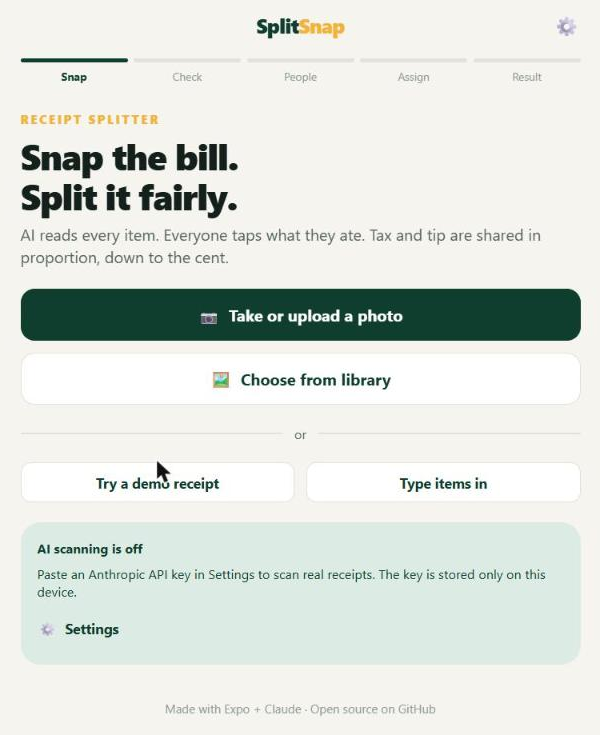
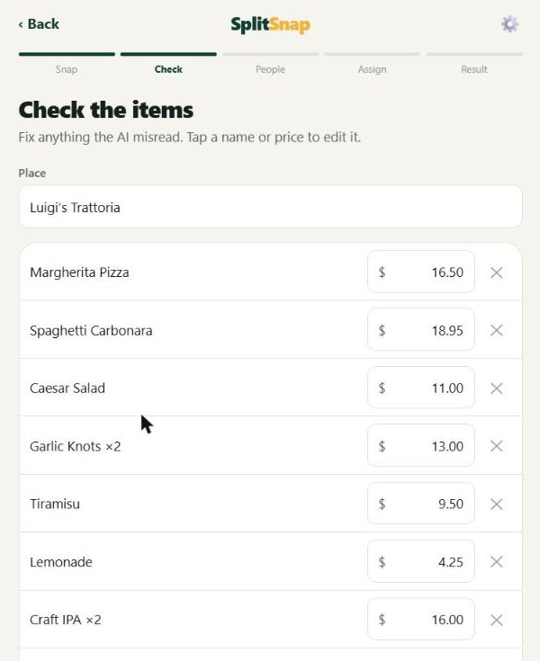
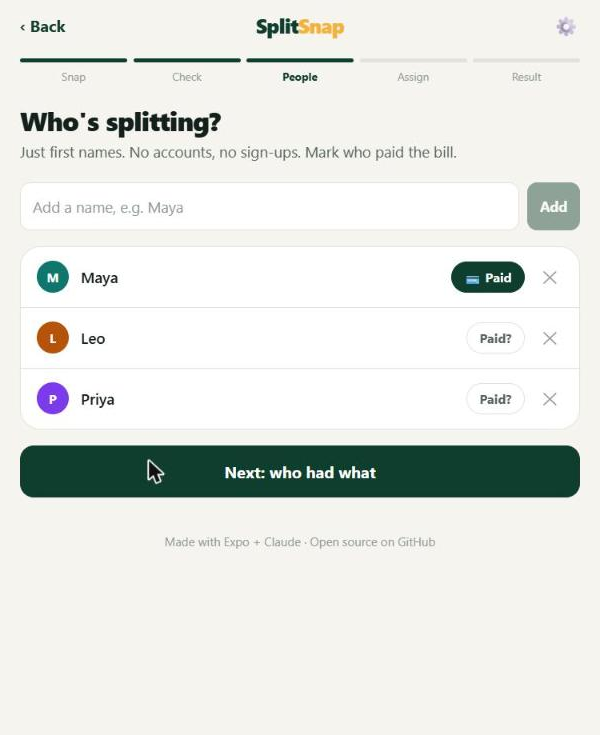
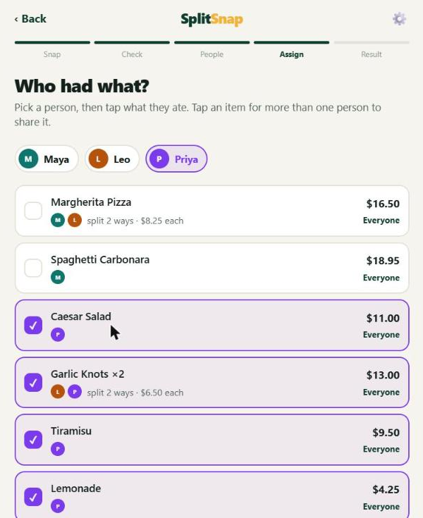
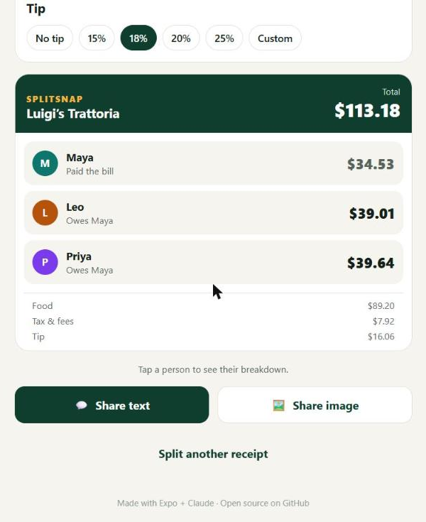
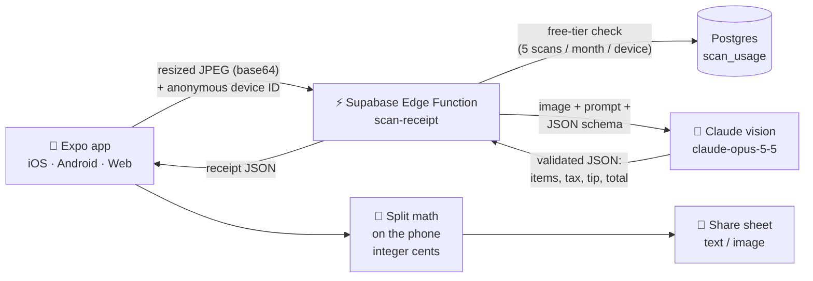

<div align="center">

# 📸 SplitSnap

### Snap the bill. Split it fairly. Down to the cent.

**Take a photo of a receipt → AI reads every item → everyone taps what they ate → SplitSnap tells each person exactly what they owe, with tax and tip shared fairly.**

[](https://tirth1263.github.io/SplitSnap-Receipt-Splitter/)
[](https://github.com/tirth1263/SplitSnap-Receipt-Splitter/actions)
[](LICENSE)


**[👉 Try it now: no install, no sign-up](https://tirth1263.github.io/SplitSnap-Receipt-Splitter/)**

</div>

---

## 🍕 The problem

Dinner with friends was great. Then the bill comes.

*"I only had a salad." "Who ordered the second round?" "How do we split the tip?" "I'll Venmo you… something."*

Everyone has been there. Splitting evenly feels unfair to the person who ordered a side salad, and splitting by hand means calculators, rounding arguments, and the person who paid quietly losing a few dollars. **SplitSnap fixes this in about 30 seconds.**

## ✨ What it does

<table>
<tr>
<td align="center" width="20%"><br/><b>1. Snap</b><br/><sub>Take or upload a photo</sub></td>
<td align="center" width="20%"><br/><b>2. Check</b><br/><sub>AI lists items; fix any mistakes</sub></td>
<td align="center" width="20%"><br/><b>3. People</b><br/><sub>Just names, no accounts</sub></td>
<td align="center" width="20%"><br/><b>4. Assign</b><br/><sub>Tap what you ate; share items</sub></td>
<td align="center" width="20%"><br/><b>5. Result</b><br/><sub>Share as text or image</sub></td>
</tr>
</table>

| Feature | Details |
|---|---|
| 📷 **Snap or pick a receipt** | Camera or photo library on iOS and Android, file and camera upload on the web. Photos are resized to about 1600px before upload, so they're about 10× smaller and cheaper to scan. |
| 🤖 **AI reads every line** | A vision model returns items, prices, tax, tip and total as **strictly validated JSON**. Quantities ("×2"), item discounts and service fees are handled. |
| ✏️ **Fix mistakes** | Every name and price is editable. Add or remove lines. SplitSnap warns you if the items don't add up to the receipt total. |
| 👥 **Names, not accounts** | Type first names. Mark who paid. Nobody has to download anything or sign up. |
| 👆 **Tap to assign, tap again to share** | Pick a person, tap what they had. Tap one item for several people and it's split evenly (*"split 3 ways · $4.33 each"*). One-tap **Everyone** and **split the rest** buttons. |
| ⚖️ **Fair tax & tip** | Tax and tip are divided **in proportion to what each person ordered**, not evenly. Choose the receipt's tip, 15/18/20/25 %, or a custom amount. |
| 🪙 **Never loses a penny** | All math is done in **integer cents**. The shares always add up to the exact bill total, and leftover cents go to the payer (more on that below). |
| 💬 **Share the result** | Native share sheet with a clean text summary for iMessage, WhatsApp and the like, or a **branded image** of the breakdown. |
| 🔒 **Private by design** | Splits are calculated on your device. Photos are used only to read the receipt and are never stored. |

## 🧮 The math (the part we're proud of)

Money bugs are sneaky. In JavaScript `0.1 + 0.2 === 0.30000000000000004`, and naive splitting like `$10 / 3` leaves you with `$3.33 × 3 = $9.99`, so a penny disappears. SplitSnap avoids both problems:

1. **Everything is an integer number of cents.** `$16.50` is stored as `1650`. User input is parsed digit by digit and never through `parseFloat`.
2. **Items** are divided evenly among the people who shared them, using `floor(price / n)`.
3. **Tax and tip** are divided by each person's food subtotal, using `floor(amount × myFood / totalFood)`.
4. **Leftover cents** from the flooring (never more than a few) go to **the person who paid**. That is the fairest home for them: the payer's share is money they owe *themselves*, so no friend is ever charged for rounding.

<details>
<summary><b>📊 Worked example: the demo receipt ($89.20 food, $7.92 tax, 18 % tip)</b></summary>

| | Maya (paid) | Leo | Priya | Total |
|---|---:|---:|---:|---:|
| Food | $27.20 | $30.75 | $31.25 | **$89.20** |
| Tax (∝ food) | $2.41 **+ 1¢** | $2.73 | $2.77 | **$7.92** |
| Tip 18 % (∝ food) | $4.89 **+ 2¢** | $5.53 | $5.62 | **$16.06** |
| **Owes** | **$34.53** | **$39.01** → Maya | **$39.64** → Maya | **$113.18** ✅ |

The 3 cents that flooring left over went to Maya, who paid. The shares add up to exactly $113.18.
</details>

The engine (`src/lib/split.ts`) is pure TypeScript with zero dependencies. It's covered by unit tests, including a **fuzz test that checks 2,000 random bills** to make sure no cent is ever lost or invented:

```bash
npm test
# ✔ shares always add up to the exact grand total
# ✔ leftover cents from an uneven item go to the payer
# ✔ tax and tip are proportional to what each person ordered
# ✔ fuzz: 2,000 random bills never lose or invent a cent
# ...
```

## 🏗️ How it works



1. **The photo goes to a server function.** The API key lives on the server, never in the app.
2. **The function asks a vision AI:** *"Read this receipt. Return items, prices, tax, tip and total as JSON."* It uses **structured outputs** with a Zod schema, so the response is guaranteed to parse, plus automatic **refusal fallbacks** to keep reliability high.
3. **The app shows the list, and the split happens on the phone.** It's simple arithmetic, so no AI is needed for that part. That keeps it instant, offline-friendly and free.
4. **No accounts to start.** Free-scan limits are enforced per anonymous device ID, atomically in Postgres, with scans refunded automatically when the AI call fails.

> **The live web demo** is a static site on GitHub Pages connected to a hosted Supabase Edge Function, so you can **scan real receipts right away**, with 5 free scans per device per month. Power users can paste their own Anthropic API key in **⚙️ Settings** for unlimited scans; it's stored only in the browser and sent only to `api.anthropic.com`. Or tap **Try a demo receipt** to see the full flow instantly.

## 🧰 Tech stack

| Layer | Tech |
|---|---|
| App | **Expo SDK 58**, React Native 0.88, React 19, **Expo Router**, TypeScript (strict) |
| Device APIs | `expo-image-picker`, `expo-image-manipulator`, `expo-sharing`, `expo-clipboard`, `react-native-view-shot` |
| AI | **Claude** (`claude-opus-5-5`) via the official `@anthropic-ai/sdk`, with structured outputs and Zod |
| Backend | **Supabase Edge Function** (Deno) + Postgres for the free-tier counter |
| Web hosting | **GitHub Pages**, built and deployed by **GitHub Actions** on every push |
| Tests | Node's built-in test runner with native TypeScript (no Jest config needed) |

## 📁 Project structure

```
SplitSnap-Receipt-Splitter/
├── src/
│   ├── app/                    # Expo Router routes
│   │   ├── _layout.tsx         # Root layout, <head> metadata
│   │   └── index.tsx           # The 5-step flow: Snap → Check → People → Assign → Result
│   ├── screens/                # One component per step + Settings sheet
│   ├── lib/
│   │   ├── split.ts            # ⭐ The cents-exact split engine
│   │   ├── split.test.ts       # Unit + fuzz tests
│   │   ├── money.ts            # Parse/format money without floats
│   │   ├── scan.ts             # Talks to the server function (or Claude directly with your own key)
│   │   ├── receiptSchema.ts    # Zod schema + prompt for the vision model
│   │   ├── billReducer.ts      # All bill state transitions
│   │   ├── image.ts            # Pick/snap + resize photos
│   │   └── share.ts            # Share text & image (native + web)
│   └── ui/                     # Theme, buttons, cards, money input
├── supabase/
│   ├── functions/scan-receipt/ # Edge Function that calls the AI
│   └── migrations/             # scan_usage table + atomic claim/refund functions
├── .github/workflows/deploy.yml  # Test → typecheck → export → deploy to Pages
└── docs/screenshots/
```

## 🚀 Getting started

### Run the app

```bash
git clone https://github.com/tirth1263/SplitSnap-Receipt-Splitter.git
cd SplitSnap-Receipt-Splitter
npm install
npx expo start          # press i (iOS), a (Android) or w (web)
```

Scan the QR code with **Expo Go** to try it on your phone. Without a backend configured, use **Try a demo receipt**, **Type items in**, or paste your own Anthropic key in Settings.

### Deploy the AI server function (Supabase)

```bash
npm i -g supabase
supabase login
supabase link --project-ref <your-project-ref>
supabase db push                                         # creates scan_usage + claim/refund functions
supabase secrets set ANTHROPIC_API_KEY=sk-ant-...        # stays on the server
supabase functions deploy scan-receipt
```

Then point the app at it. Copy `.env.example` to `.env.local`:

```bash
EXPO_PUBLIC_SCAN_URL=https://<project-ref>.supabase.co/functions/v1/scan-receipt
EXPO_PUBLIC_SUPABASE_ANON_KEY=<anon key>
```

For the hosted web build, add the same two values as **repository variables** (Settings → Secrets and variables → Actions → Variables). The workflow picks them up automatically.

Optional function secrets: `FREE_SCANS_PER_MONTH` (default `5`) and `PRO_DEVICE_IDS` (comma-separated device IDs with unlimited scans).

### Useful scripts

| Command | What it does |
|---|---|
| `npm test` | Runs the split-math tests |
| `npm run typecheck` | Strict TypeScript check |
| `npm run export:web` | Builds the static website into `dist/` (GitHub Pages-ready) |
| `npx eas-cli build` | Builds iOS/Android binaries in the cloud |

## 💰 Business model

| | **Free** | **Pro** (small yearly fee) |
|---|---|---|
| AI receipt scans | 5 / month per device | Unlimited |
| Manual entry & demo | ✅ | ✅ |
| Fair tax & tip split | ✅ | ✅ |
| Share as text / image | ✅ | ✅ |
| Saved split history | | ✅ |
| One-tap Venmo / PayPal request links | | ✅ |

**Running cost:** a few cents or less per scan for the AI. Images are downscaled before upload, and free scans are capped per device in the database.

## 🗺️ Roadmap

- [x] Snap / pick receipt photo
- [x] AI extraction to validated JSON
- [x] Editable items, tax and tip, with a total mismatch warning
- [x] Name-only people and a payer
- [x] Shared items and proportional tax & tip
- [x] Cents-exact math with fuzz tests
- [x] Share as text and image
- [x] Per-device free-scan limit (server)
- [x] Web version deployed with CI/CD
- [ ] Pro subscriptions (in-app purchase)
- [ ] Saved history and optional accounts
- [ ] Venmo / PayPal / UPI request links
- [ ] Multi-receipt trips ("who owes whom" across a weekend)
- [ ] Currency conversion for travel

## 🤝 Contributing

Issues and pull requests are welcome! If you're touching the money math, please add a test to `src/lib/split.test.ts`. The fuzz test should always stay green.

## 📄 License

[MIT](LICENSE) © tirth1263

<div align="center">
<br/>
<b>No more "I'll Venmo you later… probably."</b><br/>
<sub>Built with Expo, TypeScript and Claude.</sub>
<br/><br/>
⭐ <b>If SplitSnap saved your group chat, star the repo!</b>
</div>
